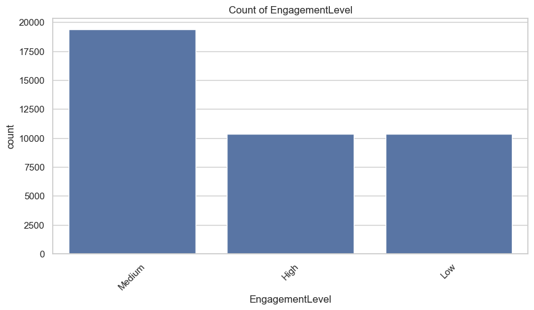
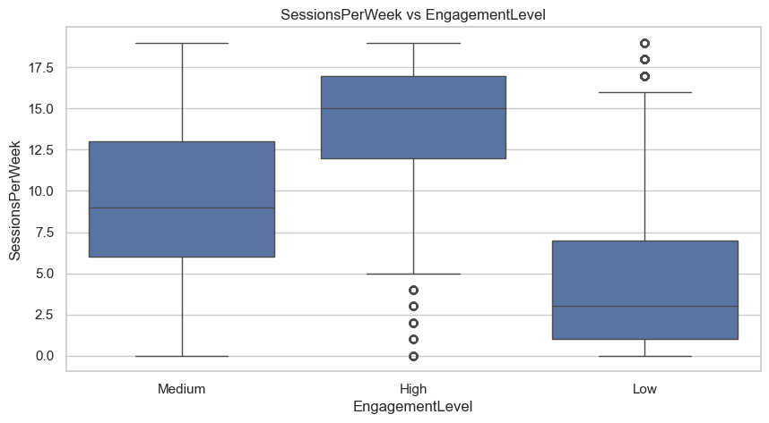
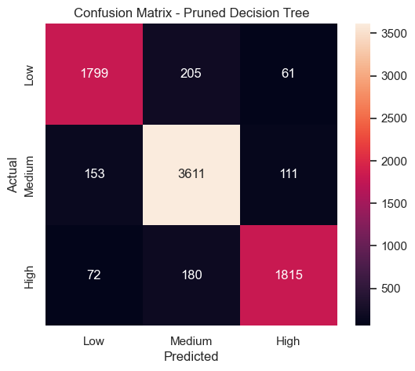
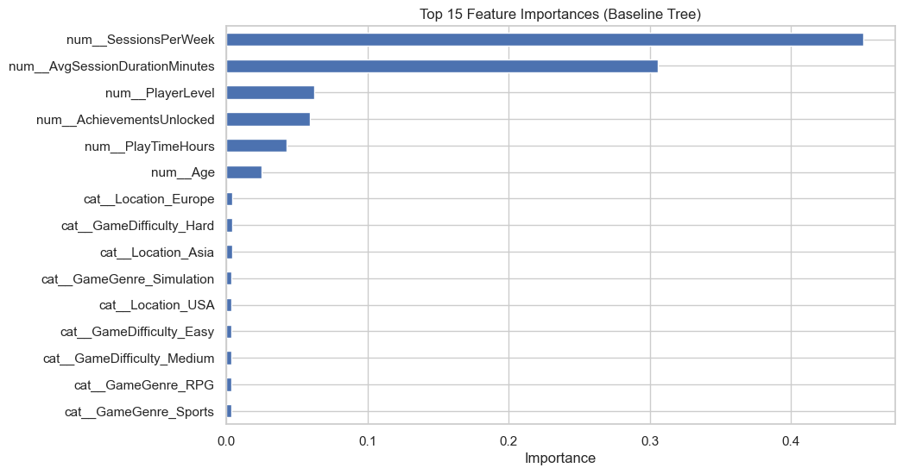

# Online Gaming Engagement Prediction

Can we tell, just from how someone plays, whether they will stay hooked on a game or slowly lose interest? That is what this project tries to find out.

I used data from about 40,000 players and built a model that sorts each player into one of three groups:

- **High**: plays a lot and loves the game
- **Medium**: plays now and then
- **Low**: barely plays and might quit soon

If a game company knows who is likely to become "Low", it can reach out early, with a small gift or a friendlier level, before the player disappears.

## The data

Each row is one player. We know things like:

- age, gender and country
- favourite game type (Action, RPG, Sports and so on)
- how many hours they play, and how many times a week
- how long one session lasts
- player level and achievements unlocked
- whether they buy things inside the game

There were no missing values and no repeated rows, so cleaning was easy.

## How many players are in each group?



About half the players are **Medium**. **High** and **Low** are about a quarter each. That is a fairly even mix, so the model did not need special tricks to handle a tiny group.

## What I found: play more often, stay more engaged



This was the clearest picture in the whole project. High players log in about **15 times a week**. Medium players about 9. Low players only about 3. Session length shows the same pattern.

## How I built it

1. Looked at every column with charts to see what separates the groups.
2. Split the players: 80% to teach the model, 20% kept hidden as a final test.
3. Put the cleaning steps and the model together in one **pipeline**, so new players can be scored the same way in one go.
4. Started with a simple **decision tree** (a set of yes/no questions).
5. Made the tree better by tuning its settings and trimming extra branches.
6. Tried stronger models: **Random Forest, Gradient Boosting and XGBoost**.
7. Checked if the groups being unequal was a problem (class weights, oversampling, SMOTE).
8. Used **SHAP** to see why the model makes its choices.

## How well did it work?

| Model | Accuracy |
|---|---|
| Plain decision tree | 83.5% |
| Tuned and trimmed decision tree | 90.2% |
| Random Forest | 89.4% |
| Gradient Boosting | 90.4% |
| XGBoost | 91.3% |
| **XGBoost, tuned (final)** | **91.6%** |

Accuracy just means "how many players did it get right". Out of every 100 new players, the final model puts about 92 in the correct group.

Fixing the small differences in group sizes (class weights, oversampling, SMOTE) made almost no difference. The data was already balanced enough.

## Where does the model make mistakes?



This table shows what the model guessed (across) against the truth (down). The big numbers on the diagonal are correct guesses. Most wrong guesses are only one step off, like calling a High player "Medium". It rarely calls a High player "Low", or the other way around. (This picture is from the trimmed decision tree. The boosted models follow the same pattern with fewer mistakes.)

## What really decides engagement?



Just two things:

1. **How many sessions a player plays each week**
2. **How long each session lasts**

Achievements and player level help a little. Age, gender, country, game type and in-game purchases hardly matter at all. I checked this three different ways (tree importance, shuffling each column, and SHAP) and all three agreed.

So the message is simple: **players who log in often and stay for a while are the ones who stay.**

## Keeping an eye on it later

Players and games change. A model that works today can slowly get worse. The plan is to check each month whether weekly sessions and session length still look like the training data, and to retrain if they drift or if accuracy drops by a few points.

## Files

| File | What it is |
|---|---|
| `Gaming_Engagement_Prediction.ipynb` | The full notebook with all steps |
| `online_gaming_behavior_dataset.csv` | The data |
| `images/` | Charts used in this page |

## How to run it

```bash
pip install pandas numpy scikit-learn matplotlib seaborn xgboost shap imbalanced-learn joblib
jupyter notebook Gaming_Engagement_Prediction.ipynb
```

Put the CSV in the same folder as the notebook, or change the file path in the first cells. Your numbers may differ a little from mine on a different computer.

## What I would try next

- Add how a player's habits change over the last few weeks, to spot someone who is starting to drift away.
- Test a small offer on predicted "Low" players and see if it really keeps them playing.
